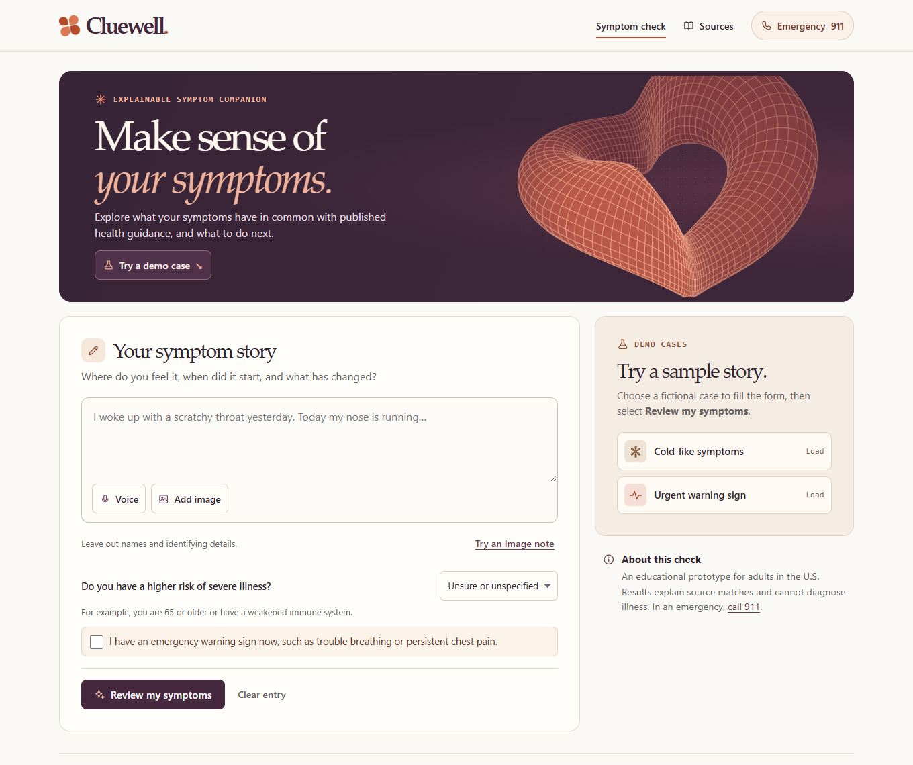
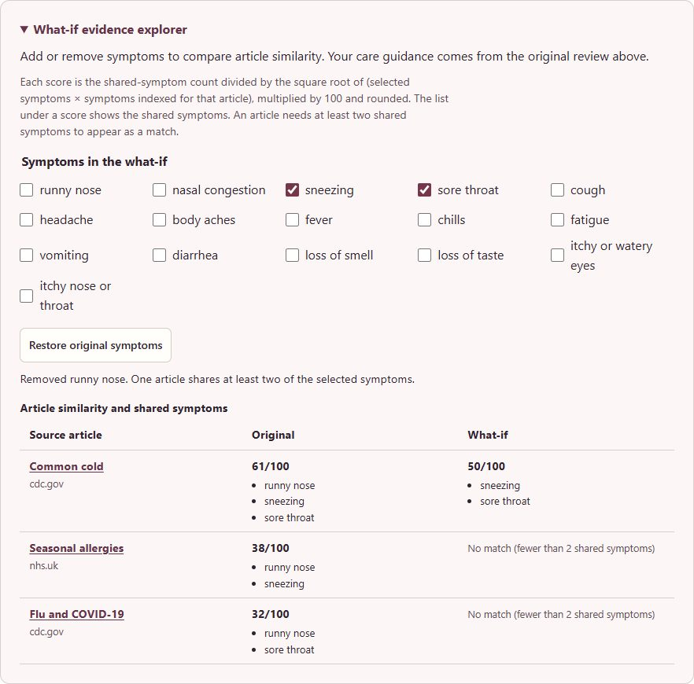
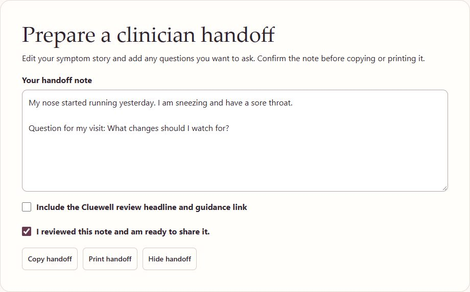
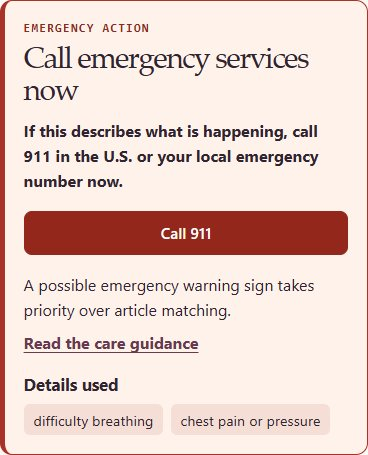
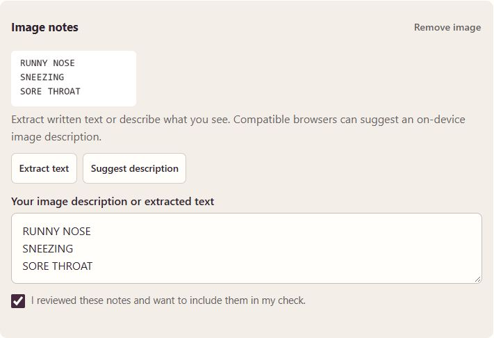

# Cluewell

Cluewell helps U.S. adults make sense of a symptom story by showing which details match public-health guidance and what those sources say to do next. Enter a written story, dictate it in a supported browser, or review text extracted from an image.

**Built for Slay Hacks 2026.** [Open the live app](https://cluewell-tfqh.netlify.app/) · [Submission write-up](SUBMISSION.md) · [Download a standalone build from GitHub Actions](https://github.com/sgohils/cluewell/actions/workflows/test.yml)



## Try the demo

1. Load **Cold-like symptoms** and select **Review my symptoms**. Each article card names the symptoms it shares with the story and links to the source.
2. Open **What-if evidence explorer**. Uncheck **runny nose** and compare the original and hypothetical scores. The explorer lists added and removed symptoms and identifies articles that fall below the matching threshold. The care guidance stays tied to the original entry.
3. Select **Prepare a clinician handoff**. Edit the draft and add a question for your visit. Review and confirm the text before copying or printing. Including the review headline and guidance link is optional.
4. Load **Urgent warning sign** and submit again. The emergency action takes priority over article matches and the handoff.
5. To try image intake, choose **Try an image note**, select **Extract text**, review the extracted words, and confirm the image notes before submitting.

### Compare evidence



### Prepare a clinician handoff



### See the emergency flow on mobile



### Review extracted image notes



## How it works

| Feature | Implementation |
| --- | --- |
| Symptom recognition | English phrase normalization maps entries to symptom concepts. Rules account for some denials, corrections, and historical context. |
| Article rankings | Cosine similarity compares recognized symptoms with three hand-indexed article profiles. At least two shared concepts are required. A score measures article overlap and has no clinical probability interpretation. |
| Care guidance | Explicit rules prioritize recognized warning signs and account for disclosed risk, low evidence, and follow-up. Linked sources come from the CDC, NHS, and MedlinePlus. |
| Dictation | Browser speech recognition adds a transcript for review. Browser support varies, and the browser’s speech provider may process audio externally. |
| Image notes | The app previews images locally and accepts reviewed text. The bundled reader handles clean uppercase monospace print. Other images may use native browser text recognition or downloadable English Tesseract.js assets. A compatible Chrome on-device model can optionally suggest a photo description. |
| Visit notes | Handoff drafts open on request and stay editable until the user confirms them for copying or printing. |

The built-in cases are fictional. Cluewell is an educational prototype with limited symptom coverage and no clinical validation. It may miss or misinterpret warning signs. Test with synthetic inputs. Entries live in page memory and clear on reload or reset. Using copy or print can leave a copy outside the app.

## Run locally

The site uses plain HTML, CSS, and JavaScript. Use Node.js 20 or later for the local server. No packages or API keys are required.

```sh
node server.cjs
```

Open [http://127.0.0.1:4173](http://127.0.0.1:4173). Use localhost or HTTPS for microphone access.

To make a portable copy with the sample image embedded:

```sh
node tools/standalone.cjs Cluewell.html
```

Open the resulting HTML file in a browser. The GitHub Actions workflow also attaches a copy named **Cluewell-standalone** to successful runs.

## Test and deploy

Run the tests with Node.js 22 or later.

```sh
node --test tests/*.test.cjs
```

The suite covers symptom interpretation and emergency priority, evidence comparison and reset, handoff review and clipboard behavior, and image-note confirmation. For a manual browser check, follow the demo above at desktop and mobile widths. Use Tab, Enter, and Space to exercise the evidence explorer and verify that the source comparison and reset work by keyboard.

| Netlify setting | Value |
| --- | --- |
| Production branch | `main` |
| Build command | Leave blank |
| Publish directory | `dist` |
| Environment variables | None required |

Netlify reads [`netlify.toml`](netlify.toml). The connected site deploys pushes to `main` and can provide pull request previews. [Live app](https://cluewell-tfqh.netlify.app/)

## Development checkpoints

The latest improvement pass used five agents over five rounds, with a separate commit for each agent’s work in each round. The merge preserved all 25 checkpoints covering evidence, clinician handoff, accessibility, symptom wording, and input regression coverage. [25-commit history](https://github.com/sgohils/cluewell/pull/4/commits)
